<div align="center">

<!-- Custom Animated Cyber-Grid Header Banner -->
<a href="https://github.com/Thranae">
  
</a>

<br />

<!-- Dynamic Animated Typing Subtitle -->
<a href="https://github.com/Thranae">
  
</a>

<br />

<!-- Profile Header Badges -->
[](https://github.com/Thranae)
[](https://linkedin.com/in/thranaeswanth)
[](https://github.com/Thranae/packwise)
[](https://github.com/Thranae)

<br /><br />

<!-- Holographic Digital Boarding Pass -->
<a href="https://github.com/Thranae/packwise">
  
</a>

<br /><br />

<p align="center">
  <i>"Resilient by default. High-performance by design. Obsessed with 60 FPS interactions and offline-first software that never breaks."</i>
</p>

</div>

---

### 👨‍💻 Engineering Identity & Architecture Stack

```typescript
interface SoftwareEngineer {
  name: string;
  title: string;
  location: string;
  focusAreas: string[];
  flagship: string;
  stack: {
    frontend: string[];
    mobile: string[];
    backend: string[];
    offlineEngine: string[];
    intelligence: string[];
    verification: string[];
  };
}

const thranae: SoftwareEngineer = {
  name: "Thranaeswanth S",
  title: "Full-Stack Systems & AI Solutions Engineer",
  location: "India",
  focusAreas: [
    "Autonomous Multi-LLM Orchestration & Failover Systems",
    "Offline-First Distributed Sync with Local IndexedDB (Dexie)",
    "60 FPS Spatial Computing & 3D Interactive Globes",
    "Universal Tri-Platform Codebases (Web PWA, iOS, Android)"
  ],
  flagship: "PackWise AI — The Autonomous Offline-First Travel Operating System",
  stack: {
    frontend: ["React 19", "Vite 6", "TailwindCSS v4", "Framer Motion", "Three.js", "MapLibre GL"],
    mobile: ["Capacitor 8", "React Native Expo", "Workbox PWA"],
    backend: ["Node.js", "Express.js", "MongoDB Atlas", "JWT Token Rotation", "SSE"],
    offlineEngine: ["Dexie.js (IndexedDB)", "Idempotent Sync Queue", "Optimistic State Mutation"],
    intelligence: ["Google Gemini 2.5 Flash", "Groq Llama 3", "OpenAI GPT-4o", "Mistral AI"],
    verification: ["GitHub Actions CI", "Playwright E2E", "Vitest", "ESLint", "Docker"]
  }
};
```

---

### 🌟 Featured Flagship Project: PackWise AI

<div align="center">

<a href="https://github.com/Thranae/packwise">
  
</a>

<br /><br />

[](https://github.com/Thranae/packwise/actions)
[](https://react.dev/)
[](https://dexie.org/)
[](https://capacitorjs.com/)
[](https://github.com/Thranae/packwise)

<br />

<a href="https://github.com/Thranae/packwise">
  
</a>

<br /><br />

<p align="center">
  <b>PackWise</b> is an enterprise-grade travel operating system engineered for volatile real-world connectivity. Powered by a self-healing multi-LLM orchestrator, local-first IndexedDB reconciliation, 60 FPS 3D spatial mapping, and universal execution across Web PWA, iOS, and Android.
</p>

</div>

| Architectural Pillar | Technical Implementation |
| :--- | :--- |
| **🧠 Multi-LLM Fallback Engine** | Eliminates single-vendor outages via a resilient priority pipeline: **Google Gemini 2.5 Flash** for strict JSON itinerary generation, **Groq Llama 3** for ultra-fast sub-300ms interactive chat, automatically falling back to **OpenAI GPT-4o** and **Mistral AI** on API rate-limits or quota exhaustion. |
| **📶 Offline-First Distributed Sync** | Local-first state mutations commit immediately to **Dexie.js (IndexedDB)** with sub-5ms optimistic latency. Mutations queue into an idempotent operation log and reconcile seamlessly with MongoDB Atlas upon network reconnection. |
| **🌐 3D Spatial Canvas & Telemetry** | Immersive global travel intelligence powered by **Three.js**, **React-Globe.gl**, and customized dark-mode **MapLibre GL** satellite vectors with spring physics and flight path radar telemetry. |
| **📱 Tri-Platform Native Distribution** | Shared architecture delivering a progressive web application (PWA) with Workbox service workers, hardware-accelerated **Capacitor 8** native runtime for iOS/Android, and an **Expo** React Native ecosystem. |
| **🛡️ Hardened Security Architecture** | Dual-JWT authentication with rotating refresh tokens stored in secure `HttpOnly`, `SameSite=Strict` cookies, protected by automated NoSQL injection sanitization (`express-mongo-sanitize`) and strict CSP headers. |

<br />

<div align="center">
  <a href="https://github.com/Thranae/packwise">
    
  </a>
</div>

<br />

<details>
<summary><b>🧬 Deep Dive: Multi-LLM Self-Healing Orchestration Architecture</b></summary>

```
              ┌──────────────────────────────────────────────┐
              │          User Task Request / Prompt          │
              └──────────────────────┬───────────────────────┘
                                     │
                     [ Multi-LLM Task Router ]
                                     │
         ┌───────────────────────────┴───────────────────────────┐
         ▼                                                       ▼
 ┌───────────────┐                                       ┌───────────────┐
 │ Gemini 2.5    │ ◄─── Primary (Structured JSON)        │ Groq Llama 3  │ ◄─── Primary (Sub-300ms Chat)
 └───────┬───────┘                                       └───────┬───────┘
         │ (Rate Limit / Timeout)                                │ (Timeout)
         ▼                                                       ▼
 ┌───────────────┐                                       ┌───────────────┐
 │ OpenAI GPT-4o │ ◄─── Secondary Fallback               │ Mistral AI    │ ◄─── Secondary Fallback
 └───────┬───────┘                                       └───────┬───────┘
         │                                                       │
         └───────────────────────────┬───────────────────────────┘
                                     ▼
                     [ Validated Response Stream ]
```

</details>

<details>
<summary><b>⚡ Deep Dive: Offline-First Distributed State Reconciliation</b></summary>

```
  User Action (Create/Edit Trip, Toggle Item, Budget Mutation)
                             │
                             ▼
  ┌────────────────────────────────────────────────────────┐
  │ 1. Local-First Write: Dexie.js (IndexedDB)             │
  │    → Immediate UI update (0ms perceived latency)       │
  │    → Append mutation record to syncQueue table         │
  └──────────────────────────┬─────────────────────────────┘
                             │
            Network Available? ─── NO ───► Queue persisted safely offline
                             │
                            YES
                             │
                             ▼
  ┌────────────────────────────────────────────────────────┐
  │ 2. Background Reconciler (syncService.js)              │
  │    → Replay idempotent operations sequentially         │
  │    → Server validates & updates MongoDB Atlas          │
  │    → Flush resolved queue items                        │
  └────────────────────────────────────────────────────────┘
```

</details>

---

### 🛠️ Technical Arsenal & Ecosystem

| Layer | Technologies, Frameworks & Libraries |
| :--- | :--- |
| **Frontend & 3D Spatial** |       |
| **Cross-Platform Mobile** |     |
| **Backend & Gateways** |      |
| **Databases & Offline Storage** |    |
| **AI & Autonomous Agents** |     |
| **DevOps & Verification** |     |

---

### 📊 Real-Time GitHub Telemetry & Stats

<div align="center">
  
  &nbsp;&nbsp;
  
</div>

<br />

<div align="center">
  
</div>

---

### 💡 Core Engineering Principles

1. **Failure Is a First-Class State**: Never assume the network or third-party APIs will respond. Every feature must have local fallbacks, optimistic client updates, and deterministic background sync.
2. **Sub-16ms Frame Budgets**: If an animation stutters, it destroys the user's perception of quality. Optimize bundle chunking, decouple main-thread blocking operations, and embrace GPU-accelerated transforms.
3. **Defense-in-Depth Security**: Avoid storing sensitive credentials in vulnerable localStorage. Use rotating HttpOnly cookies, sanitize every incoming payload, and enforce strict Content Security Policies.

---

<div align="center">

### 🤝 Let's Connect & Collaborate

[](https://linkedin.com/in/thranaeswanth)
[](mailto:thranae7@gmail.com)
[](https://github.com/Thranae)

<br /><br />

<!-- Sleek Animated Cyber-Pulse Divider -->


</div>
