<div align="center">

<!-- Custom Animated Cyber-Grid Header Banner -->
<a href="https://github.com/Thranae">
  
</a>

<br />

<!-- Dynamic Animated Typing Subtitle -->
<a href="https://github.com/Thranae">
  
</a>

<br />

<!-- Profile Header Badges -->
[](https://github.com/Thranae)
[](https://linkedin.com/in/thranaeswanth)
[](https://github.com/Thranae/packwise#readme)
[](https://github.com/Thranae)

<br /><br />

<!-- Animated Real-Time Architecture & System Telemetry Radar (Live Oscilloscope + Signal Blips + HUD Counters) -->
<a href="https://github.com/Thranae/packwise#readme">
  
</a>

<br /><br />

<!-- Animated Flow State & Developer Focus Terminal -->


<br /><br />

<p align="center">
  <i>"Resilient by default. High-performance by design. Obsessed with 60 FPS interactions and offline-first software that never breaks."</i>
</p>

</div>

<br />


<br />

### 👨‍💻 Engineering Identity & Architecture Stack

```typescript
interface SoftwareEngineer {
  name: string;
  title: string;
  location: string;
  focusAreas: string[];
  flagship: {
    name: string;
    readmeUrl: string;
    architecture: string;
  };
  stack: {
    frontend: string[];
    spatial3D: string[];
    mobile: string[];
    backend: string[];
    offlineEngine: string[];
    intelligence: string[];
    verification: string[];
  };
}

const thranae: SoftwareEngineer = {
  name: "Thranaeswanth S",
  title: "Full-Stack Systems & AI Solutions Engineer",
  location: "India",
  focusAreas: [
    "Autonomous Multi-LLM Orchestration & Failover Systems",
    "Offline-First Distributed Sync with Local IndexedDB (Dexie)",
    "60 FPS Spatial Computing & 3D Interactive Globes (Three.js)",
    "Universal Tri-Platform Codebases (Web PWA, iOS, Android)"
  ],
  flagship: {
    name: "PackWise AI",
    readmeUrl: "https://github.com/Thranae/packwise#readme",
    architecture: "Decoupled Local-First Client Mesh with Self-Healing Multi-LLM Gateway"
  },
  stack: {
    frontend: ["React 19", "Vite 6", "TailwindCSS v4", "Framer Motion"],
    spatial3D: ["Three.js", "React-Globe.gl", "MapLibre GL", "Spring Physics"],
    mobile: ["Capacitor 8", "React Native Expo", "Workbox PWA"],
    backend: ["Node.js", "Express.js", "MongoDB Atlas", "JWT Token Rotation", "SSE"],
    offlineEngine: ["Dexie.js (IndexedDB)", "Idempotent Sync Queue", "Optimistic State Mutation"],
    intelligence: ["Google Gemini 2.5 Flash", "Groq Llama 3", "OpenAI GPT-4o", "Mistral AI"],
    verification: ["GitHub Actions CI", "Playwright E2E", "Vitest", "ESLint", "Docker"]
  }
};
```

<br />


<br />

### 🛠️ Dynamic Technical Arsenal & Capabilities

<div align="center">

<!-- Animated Interactive Skill Matrix -->
<a href="https://github.com/Thranae">
  
</a>

</div>

<br />

| Capability Domain | Technologies, Frameworks & Deep Implementations |
| :--- | :--- |
| **🧠 Autonomous AI & Multi-Model Mesh** | **Google Gemini 2.5 Flash** (Schema-constrained JSON synthesis), **Groq Llama 3** (Sub-300ms real-time chat), **OpenAI GPT-4o** (Autonomous reasoning fallback), **Mistral AI** (Self-healing failover), SSE streaming token pipeline. |
| **⚡ Frontend & 3D Spatial Canvas** | **React 19**, **Vite 6**, **Tailwind CSS v4**, **Three.js**, **React-Globe.gl**, **Framer Motion**, **MapLibre GL** dark vector tiles, sub-16ms GPU render loops. |
| **📶 Distributed Storage & Offline Sync** | **Dexie.js (IndexedDB)** local-first schema, idempotent mutation logs, optimistic zero-latency UI updates, automatic reconciliation upon network reconnection, **MongoDB Atlas** backend persistence. |
| **📱 Cross-Platform Universal Runtime** | **Capacitor 8** native hardware bindings (iOS & Android), **React Native Expo** architecture, **Workbox PWA** service workers with background sync capabilities. |
| **🛡️ Hardened Backend & Gateways** | **Node.js**, **Express.js**, dual-JWT authentication with rotating refresh tokens stored in `HttpOnly` / `SameSite=Strict` cookies, NoSQL injection sanitization (`express-mongo-sanitize`), `helmet` CSP protection. |
| **🧪 Testing, Verification & CI/CD** | **GitHub Actions** automated test matrix, **Playwright** end-to-end multi-browser test harness, **Vitest** unit testing, **Docker** containerized environments. |

<br />


<br />

### 🌟 Featured Flagship Project: PackWise AI

<div align="center">

<!-- Banner links straight to PackWise README -->
<a href="https://github.com/Thranae/packwise#readme">
  
</a>

<br /><br />

[](https://github.com/Thranae/packwise/actions)
[](https://react.dev/)
[](https://dexie.org/)
[](https://capacitorjs.com/)
[](https://github.com/Thranae/packwise#readme)

<br />

<!-- App Preview linking directly to PackWise README -->
<a href="https://github.com/Thranae/packwise#readme">
  
</a>

<br /><br />

<p align="center">
  <b>PackWise</b> is an enterprise-grade travel operating system engineered for volatile real-world connectivity. Powered by a self-healing multi-LLM orchestrator, local-first IndexedDB reconciliation, 60 FPS 3D spatial mapping, and universal execution across Web PWA, iOS, and Android.
</p>

<!-- 1-Click README Direct Action Button -->
<a href="https://github.com/Thranae/packwise#readme">
  
</a>
&nbsp;&nbsp;
<a href="https://codespaces.new/Thranae/packwise">
  
</a>

</div>

<br />

| Architectural Pillar | Traditional Travel Software | PackWise Autonomous OS Implementation |
| :--- | :--- | :--- |
| **🧠 Multi-LLM Fallback Engine** | Single API endpoint (Crashes on HTTP 429/500 rate limits) | **Google Gemini 2.5 Flash** for strict JSON itineraries, **Groq Llama 3** for sub-300ms interactive chat, automatically failing over to **OpenAI GPT-4o** and **Mistral AI** on API errors or quota limits. |
| **📶 Offline-First Distributed Sync** | Network-dependent (Blank screens and blocked UI when offline) | **Dexie.js (IndexedDB)** local store commits mutations in < 4ms. Mutations queue into an idempotent operation log that reconciles with MongoDB Atlas when reconnected. |
| **🌐 3D Spatial Canvas & Telemetry** | Flat static forms and slow map loads | Immersive global travel intelligence powered by **Three.js**, **React-Globe.gl**, and dark-mode **MapLibre GL** satellite vectors with spring physics and flight radar telemetry at **60 FPS locked**. |
| **📱 Tri-Platform Native Distribution** | Fractured, fragmented codebases for web and mobile | Unified code sharing delivering a progressive web app (**Workbox PWA**), hardware-accelerated **Capacitor 8** native runtime for iOS/Android, and an **Expo** ecosystem. |
| **🛡️ Hardened Security Architecture** | Vulnerable tokens stored in client localStorage | Dual-JWT authentication with rotating refresh tokens stored in secure `HttpOnly`, `SameSite=Strict` cookies, protected by automated NoSQL injection sanitization and strict CSP headers. |

<br />

<details>
<summary><b>🧬 Deep Dive: Multi-LLM Self-Healing Orchestration Architecture</b></summary>

```
              ┌──────────────────────────────────────────────┐
              │          User Task Request / Prompt          │
              └──────────────────────┬───────────────────────┘
                                     │
                     [ Multi-LLM Task Router ]
                                     │
         ┌───────────────────────────┴───────────────────────────┐
         ▼                                                       ▼
 ┌───────────────┐                                       ┌───────────────┐
 │ Gemini 2.5    │ ◄─── Primary (Structured JSON)        │ Groq Llama 3  │ ◄─── Primary (Sub-300ms Chat)
 └───────┬───────┘                                       └───────┬───────┘
         │ (Rate Limit / Timeout)                                │ (Timeout)
         ▼                                                       ▼
 ┌───────────────┐                                       ┌───────────────┐
 │ OpenAI GPT-4o │ ◄─── Secondary Fallback               │ Mistral AI    │ ◄─── Secondary Fallback
 └───────┬───────┘                                       └───────┬───────┘
         │                                                       │
         └───────────────────────────┬───────────────────────────┘
                                     ▼
                     [ Validated Response Stream ]
```

</details>

<details>
<summary><b>⚡ Deep Dive: Offline-First Distributed State Reconciliation</b></summary>

```
  User Action (Create/Edit Trip, Toggle Item, Budget Mutation)
                             │
                             ▼
  ┌────────────────────────────────────────────────────────┐
  │ 1. Local-First Write: Dexie.js (IndexedDB)             │
  │    → Immediate UI update (0ms perceived latency)       │
  │    → Append mutation record to syncQueue table         │
  └──────────────────────────┬─────────────────────────────┘
                             │
            Network Available? ─── NO ───► Queue persisted safely offline
                             │
                            YES
                             │
                             ▼
  ┌────────────────────────────────────────────────────────┐
  │ 2. Background Reconciler (syncService.js)              │
  │    → Replay idempotent operations sequentially         │
  │    → Server validates & updates MongoDB Atlas          │
  │    → Flush resolved queue items                        │
  └────────────────────────────────────────────────────────┘
```

</details>

<br />


<br />

### 📊 Real-Time GitHub Telemetry & Stats

<div align="center">
  
  &nbsp;&nbsp;
  
</div>

<br />

<div align="center">
  
</div>

<br />

<div align="center">
  <!-- Dynamic GitHub Activity Graph -->
  
</div>

<br />


<br />

### 💡 Core Engineering Principles

1. **Failure Is a First-Class State**: Never assume the network or third-party APIs will respond. Every feature must have local fallbacks, optimistic client updates, and deterministic background sync.
2. **Sub-16ms Frame Budgets**: If an animation stutters, it destroys the user's perception of quality. Optimize bundle chunking, decouple main-thread blocking operations, and embrace GPU-accelerated transforms.
3. **Defense-in-Depth Security**: Avoid storing sensitive credentials in vulnerable localStorage. Use rotating HttpOnly cookies, sanitize every incoming payload, and enforce strict Content Security Policies.
4. **Local-First Data Sovereignty**: Users should own their data directly on their local device before any server roundtrip is initiated.

<br />


<br />

<div align="center">

### 🤝 Let's Connect & Collaborate

[](https://linkedin.com/in/thranaeswanth)
[](mailto:thranae7@gmail.com)
[](https://github.com/Thranae)
[](https://github.com/Thranae/packwise#readme)

<br /><br />

<!-- Sleek Animated Cyber-Pulse Divider -->


</div>
