<div align="center">

<!-- Custom Animated Cyber-Grid Header Banner -->
<a href="https://github.com/Thranae">
  
</a>

<br />

<!-- Dynamic Animated Typing Subtitle -->
<a href="https://github.com/Thranae">
  
</a>

<br />

<!-- Clean Minimal Status Badges -->
[](https://github.com/Thranae)
[](https://linkedin.com/in/thranaeswanth)
[](https://github.com/Thranae/packwise#readme)
[](https://github.com/Thranae/NEARO)
[](https://github.com/Thranae)

<br /><br />

<p align="center">
  Systems engineer focused on high-performance distributed architectures, offline-first client storage engines, geospatial computing, and autonomous multi-LLM orchestration. Committed to sub-16ms response budgets, resilient fault-tolerance, and robust data integrity across volatile real-world networks.
</p>

</div>

---

### 👨‍💻 Engineering Identity & Architecture Stack

```typescript
interface SoftwareEngineer {
  name: string;
  title: string;
  location: string;
  focusAreas: string[];
  keyProjects: {
    flagship: string;
    geospatial: string;
    foundations: string;
  };
  stack: {
    frontend: string[];
    spatialAndGeo: string[];
    mobile: string[];
    backend: string[];
    offlineAndData: string[];
    intelligence: string[];
    verification: string[];
  };
}

const thranae: SoftwareEngineer = {
  name: "Thranaeswanth S",
  title: "Full-Stack Systems & AI Solutions Engineer",
  location: "India",
  focusAreas: [
    "Autonomous Multi-LLM Orchestration & Dynamic Failover Meshes",
    "Offline-First Distributed Sync with Local IndexedDB (Dexie)",
    "Real-Time Geospatial Indexing & Proximity Projections",
    "60 FPS Spatial Computing & 3D Interactive Globes (Three.js)",
    "Universal Tri-Platform Codebases (Web PWA, iOS, Android)"
  ],
  keyProjects: {
    flagship: "PackWise AI — Autonomous Travel OS & Multi-LLM Spatial Intelligence",
    geospatial: "NEARO — Real-Time Hyperlocal Geo-Proximity & Discovery Platform",
    foundations: "Library Management System — Object-Oriented Domain Architecture"
  },
  stack: {
    frontend: ["React 19", "Vite 6", "TailwindCSS v4", "Framer Motion"],
    spatialAndGeo: ["Three.js", "React-Globe.gl", "MapLibre GL", "Geospatial Indexing", "Haversine Algorithms"],
    mobile: ["Capacitor 8", "React Native Expo", "Workbox PWA"],
    backend: ["Node.js", "Express.js", "PostgreSQL", "MongoDB Atlas", "JWT Rotation", "SSE"],
    offlineAndData: ["Dexie.js (IndexedDB)", "Idempotent Sync Queue", "Optimistic State Mutation"],
    intelligence: ["Google Gemini 2.5 Flash", "Groq Llama 3", "OpenAI GPT-4o", "Mistral AI", "Compromise NLP"],
    verification: ["GitHub Actions CI", "Playwright E2E", "Vitest", "ESLint", "Docker"]
  }
};
```

---

### 🚀 Featured Engineering Projects

<br />

#### 1. 🌐 [PackWise AI](https://github.com/Thranae/packwise#readme) — The Autonomous Travel Operating System

<div align="center">

<a href="https://github.com/Thranae/packwise#readme">
  
</a>

<br /><br />

[](https://github.com/Thranae/packwise/actions)
[](https://react.dev/)
[](https://dexie.org/)
[](https://capacitorjs.com/)
[](https://github.com/Thranae/packwise#readme)

<br />

<a href="https://github.com/Thranae/packwise#readme">
  
</a>

</div>

<br />

PackWise is an enterprise-grade travel operating system engineered from first principles for volatile real-world networks (subways, transatlantic flights, remote destinations).

* **Offline-First Distributed Sync**: Local-first state mutations commit immediately to **Dexie.js (IndexedDB)** with sub-4ms optimistic latency. Mutations queue into an idempotent operation log and reconcile seamlessly with MongoDB Atlas upon network reconnection.
* **Self-Healing Multi-LLM Orchestrator**: Eliminates single-vendor downtime via a resilient priority pipeline: **Google Gemini 2.5 Flash** for strict JSON itinerary generation, **Groq Llama 3** for sub-300ms chat, automatically falling back to **OpenAI GPT-4o** and **Mistral AI** on API errors or quota limits.
* **60 FPS 3D Spatial Canvas**: Real-time travel mapping with **Three.js**, **React-Globe.gl**, and dark-mode **MapLibre GL** satellite vectors with spring physics and flight radar telemetry.
* **Tri-Platform Code Sharing**: Shared architecture powering a progressive web app (**Workbox PWA**), hardware-accelerated **Capacitor 8** native runtime for iOS/Android, and an **Expo** React Native ecosystem.

<div align="center">
  <a href="https://github.com/Thranae/packwise#readme">
    
  </a>
  &nbsp;&nbsp;
  <a href="https://codespaces.new/Thranae/packwise">
    
  </a>
</div>

<br /><br />

---

<br />

#### 2. 📍 [NEARO](https://github.com/Thranae/NEARO) & [nearo-backend](https://github.com/Thranae/nearo-backend) — Hyperlocal Geo-Proximity & Discovery Engine

NEARO is a real-time, location-aware proximity platform engineered for instantaneous discovery of nearby nodes, community services, and active local hubs.

| Architecture Layer | Core Technologies | Technical Specification & Implementation |
| :--- | :--- | :--- |
| **Frontend Web Client** | `React` `Vite` `Geolocation API` `Tailwind` | Lightweight, high-responsiveness web application built for fast mobile browser rendering and dynamic location tracking ([Explore Repo](https://github.com/Thranae/NEARO)). |
| **Geospatial API Engine** | `Node.js` `Express.js` `PostgreSQL` | Dedicated backend service featuring spatial coordinate indexing, radius calculation queries, and distance clustering ([Explore Backend](https://github.com/Thranae/nearo-backend)). |
| **Natural Language Routing** | `Compromise NLP` `Pattern Matching` | Embedded lightweight NLP tokenizer for semantic extraction of user search intents without heavy external cloud overhead. |
| **Real-Time Data Routing** | `Express Router` `JWT` `Connection Pool` | Modular service controllers managing authentication, live location streams, administrative telemetry, and peer communication routes. |

<div align="center">
  <a href="https://github.com/Thranae/NEARO">
    
  </a>
  &nbsp;&nbsp;
  <a href="https://github.com/Thranae/nearo-backend">
    
  </a>
</div>

<br /><br />

---

<br />

#### 3. 📚 [Library Management System](https://github.com/Thranae/Library-management-system) — Object-Oriented Architecture

A clean, modular Python application implementing object-oriented programming (OOP) principles, structured domain modeling, catalog indexing, and transactional integrity.

* **Domain-Driven Design**: Clean separation between entity definitions, inventory repositories, and transaction managers.
* **State & Transaction Validation**: Automated handling of checkouts, overdue penalty calculations, and member validation.

<div align="center">
  <a href="https://github.com/Thranae/Library-management-system">
    
  </a>
</div>

<br />

---

### 🛠️ Technical Architecture & Systems Stack

| Architectural Tier | Technologies & Frameworks | System Role & Architectural Purpose |
| :--- | :--- | :--- |
| **Client & 3D Spatial Canvas** | `React 19` `Vite 6` `Three.js` `Tailwind v4` `Framer Motion` `MapLibre GL` | Sub-16ms GPU render loops, 60 FPS spatial globe, hardware-accelerated animations |
| **Universal Native & Mobile** | `Capacitor 8` `React Native Expo` `Workbox PWA` | Native iOS/Android device bridge, background sync workers, offline application shell |
| **Distributed Gateway & APIs** | `Node.js` `Express.js` `REST APIs` `SSE Streams` `JWT Token Rotation` | Non-blocking I/O gateway, HttpOnly security boundaries, real-time event streaming |
| **Local-First & Data Engine** | `Dexie.js (IndexedDB)` `MongoDB Atlas` `PostgreSQL` `Mongoose ODM` | Sub-4ms optimistic client mutations, idempotent sync log, relational integrity |
| **Autonomous AI & NLP Mesh** | `Google Gemini 2.5 Flash` `Groq Llama 3` `OpenAI GPT-4o` `Compromise NLP` | Schema-enforced JSON synthesis, sub-300ms chat, deterministic multi-LLM failover |
| **Languages & Systems Core** | `TypeScript` `JavaScript (ESNext)` `Python` `SQL` | Strict end-to-end type safety, asynchronous concurrency, object-oriented domain models |
| **Testing, CI/CD & Verification** | `GitHub Actions` `Playwright E2E` `Vitest` `Docker` `ESLint` | Automated multi-browser verification, unit test runner, containerized runtime environments |

<br />

---

### 📊 GitHub Activity & Telemetry

<div align="center">
  
  &nbsp;&nbsp;
  
</div>

<br />

<div align="center">
  
</div>

<br />

---

### 💡 Core Engineering Principles

1. **Failure Is a First-Class State**: Never assume the network or third-party APIs will respond. Every feature must have local fallbacks, optimistic client updates, and deterministic background sync.
2. **Sub-16ms Frame Budgets**: If an animation stutters, it destroys the user's perception of quality. Optimize bundle chunking, decouple main-thread blocking operations, and embrace GPU-accelerated transforms.
3. **Defense-in-Depth Security**: Avoid storing sensitive credentials in vulnerable localStorage. Use rotating HttpOnly cookies, sanitize every incoming payload, and enforce strict Content Security Policies.
4. **Local-First Data Sovereignty**: Users should own their data directly on their local device before any server roundtrip is initiated.

<br />

---

<div align="center">

### 🤝 Let's Connect & Collaborate

[](https://linkedin.com/in/thranaeswanth)
[](mailto:thranae7@gmail.com)
[](https://github.com/Thranae)
[](https://github.com/Thranae/packwise#readme)

<br /><br />

<!-- Sleek Animated Cyber-Pulse Divider -->


</div>
